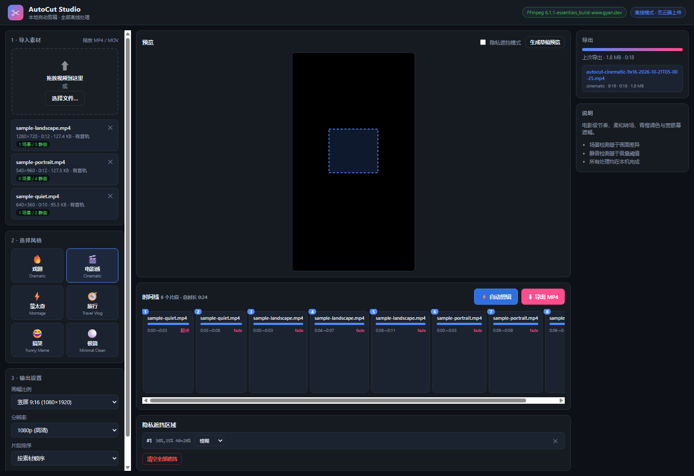

# AutoCut Studio

> **An open-source, local-first automatic video editor with customizable editing styles, video previews, privacy redaction, and MP4 export.**

AutoCut Studio turns a pile of raw clips into a finished video: drop your footage in, pick an editing style, and it detects scenes, removes silence, builds a timeline, and renders a shareable MP4 — entirely on your own machine.

**No cloud. No upload. No API keys. No model downloads.** Your footage never leaves the computer.



---

## Table of Contents

- [Overview](#overview)
- [Features](#features)
- [Editing Presets](#editing-presets)
- [Requirements](#requirements)
- [Quick Start (Windows)](#quick-start-windows)
- [FFmpeg Setup](#ffmpeg-setup)
- [Using AutoCut Studio](#using-autocut-studio)
- [Running the Tests](#running-the-tests)
- [Architecture](#architecture)
- [Privacy and Local Processing](#privacy-and-local-processing)
- [Known Limitations](#known-limitations)
- [Roadmap](#roadmap)
- [Credits and Acknowledgements](#credits-and-acknowledgements)
- [License](#license)

---

## Overview

AutoCut Studio is a small Node.js + Express application with a plain HTML/CSS/JS front end. It drives [FFmpeg](https://ffmpeg.org/)'s filter graph to do the actual editing work, so there is no proprietary engine and nothing to license per install.

The whole pipeline is open to inspection:

```
drag in clips
   └─> ffprobe      reads resolution, fps, duration, codecs
   └─> scene detection    (ffmpeg `select` filter, 0.35 scene threshold)
   └─> silence detection  (ffmpeg `silencedetect`, -32 dB / 0.35 s)
   └─> loudness measurement (ffmpeg `ebur128`, LUFS)
   └─> timeline planning   (pure JS: score, trim, order, budget clips)
   └─> render           (one `filter_complex`: trim → grade → zoompan
                        → xfade/acrossfade → concat → redaction → H.264/AAC)
   └─> sample-output.mp4
```

---

## Features

| Capability | Notes |
|---|---|
| **Drag-and-drop import** | MP4, MOV, M4V, WebM, MKV, AVI. Multi-select. Files are copied into a local `media/uploads/` directory. |
| **Automatic scene detection** | FFmpeg `select` filter finds visual cuts; each cut becomes a segment boundary. |
| **Automatic silence detection & removal** | `silencedetect` finds quiet stretches; they are excluded from the cut. Threshold and minimum duration are per-preset. |
| **Automatic multi-clip assembly** | Segments from every imported file are scored, trimmed to the preset's pacing, and interleaved into one timeline. |
| **Visual timeline** | Every clip is a card showing its source, in/out points, duration and incoming transition. |
| **Manual editing** | Drag in/out handles to trim, change transition type and duration, reorder clips, remove clips. Changes persist immediately. |
| **Real video preview** | A low-resolution draft renders in the background and plays in a `<video>` element with HTTP Range support, so seeking works. |
| **MP4 export** | H.264 + AAC in an MP4 container, with `+faststart` for web playback. Live progress via FFmpeg's `-progress` stream. |
| **9:16 and 16:9 output** | Portrait (1080×1920), landscape (1920×1080) and 1:1 (1080×1080). Correct orientation is enforced, including letterboxing. |
| **Privacy redaction** | Drag a box over anything sensitive — a face, a house number, a licence plate — and blur, pixelate, or black it out. Baked into the export. |
| **Loudness normalization** | Each clip's LUFS is measured with `ebur128` and compensated to a target. |
| **Six editing presets** | Each one measurably changes the rendered pixels — see below. |

---

## Editing Presets

Six styles are available. They are not cosmetic: every preset changes the colour grade, the transition, the camera motion, the pacing and the silence handling, and the difference is verifiable at the pixel level.

| Preset | Colour grade | Transition | Camera motion | Other |
|---|---|---|---|---|
| 🔥 **Dramatic** | `eq=contrast=1.38:saturation=1.55` | `fadeblack` 0.28 s | 16 % push + 22 % punch-in | Short clips (0.8–3 s), slight speed-up, vignette |
| 🎬 **Cinematic** | `eq=contrast=1.16` + `colorbalance` + `curves` (teal/orange) | `fade` 0.75 s | Slow 8 % push-in | Letterbox bars, long clips (3–7 s), no speed-up |
| ⚡ **Montage** | `eq=contrast=1.26:saturation=1.38` + `unsharp` | `wipeleft` 0.22 s | 12 % push + 10 % punch | Very short clips (0.6–2 s), sharpened, high saturation |
| 🧭 **Travel Vlog** | `eq=contrast=1.06:saturation=1.16:brightness=0.035` + `curves` | `fade` 0.55 s | Slow 10 % push-in | Long clips (3.5–9 s), airy bright grade, no vignette to speak of |
| 😂 **Funny Meme** | `eq=contrast=1.42:saturation=1.6` + `unsharp` | `zoomin` 0.25 s | 30 % punch-in | Short clips (0.7–2.4 s), speed-up to 1.18× |
| ⚪ **Minimal Clean** | `eq=contrast=1.02:saturation=1.0` | `cut` (hard cut) | None | Medium clips, no vignette, natural colour |

### Proof that the presets differ

Rather than asserting this, the project measures it. `tests/verify-output.js` renders the same timeline in every preset and compares the frames pixel by pixel:

```
cinematic vs dramatic: mean pixel diff = 13.08
cinematic vs meme:     mean pixel diff = 27.66
cinematic vs minimal:  mean pixel diff = 48.39
dramatic  vs meme:     mean pixel diff = 21.04
dramatic  vs minimal:  mean pixel diff = 44.04
meme      vs minimal:  mean pixel diff = 23.00

PASS  every preset pair produces different picture content  6/6 pairs differ
```

The privacy redaction is verified the same way — pixels **inside** the region change, pixels **outside** it do not:

```
PASS  pixels INSIDE the region changed (pixelate)  mean diff=6.2/255, 13005/49248 pixels changed
PASS  pixels OUTSIDE the region unchanged (pixelate)  mean diff=0.36/255
PASS  pixels INSIDE the region changed (blur)       mean diff=7.7/255, 8825/49248 pixels changed
PASS  pixels OUTSIDE the region unchanged (blur)      mean diff=0.45/255
PASS  pixels INSIDE the region changed (box)        mean diff=120.0/255, 49248/49248 pixels changed
PASS  pixels OUTSIDE the region unchanged (box)       mean diff=0.44/255
```

---

## Requirements

| | |
|---|---|
| **OS** | Windows 10/11 (the launcher is a `.cmd`). The server itself is cross-platform Node.js. |
| **Node.js** | 20 or newer (developed and tested on v24.19.0) |
| **FFmpeg + FFprobe** | 6.x recommended. Provided automatically by `npm run setup:ffmpeg`. |
| **Browser** | Any modern Chromium, Firefox or Safari. |
| **Disk** | ~120 MB for the vendored FFmpeg binaries plus your own media. |
| **Network** | Only for the one-time `npm install` and FFmpeg download. **The editor itself works fully offline.** |

---

## Quick Start (Windows)

```bash
git clone https://github.com/tina1yan/autocut-studio.git
cd autocut-studio

npm install --ignore-scripts    # see the note below
npm run setup:ffmpeg            # downloads FFmpeg + FFprobe into ./vendor
npm start
```

> `<owner>` is the GitHub account the repository was published under. If you
> cloned a copy and want the links in the docs to point at your own fork, run
> `node scripts/set-repo-owner.js <your-handle>` once.

Then open <http://127.0.0.1:3210>.

### Or just double-click the launcher

```
Start-AutoCut.cmd
```

The launcher checks Node.js, provisions FFmpeg if it is missing, installs dependencies on first run, starts the server and opens your browser.

If port **3210** is already taken by an unrelated program, the launcher says so and tells you how to pick another port — it never kills a process it does not own:

```powershell
$env:PORT=3211; npm start
```

> **Why `--ignore-scripts`?** `ffmpeg-static` and `ffprobe-static` download binaries in a `postinstall` hook. This project fetches the same binaries itself, in a way you can see and audit, via `npm run setup:ffmpeg`. Skipping lifecycle scripts keeps `npm install` from running unreviewed code.

---

## FFmpeg Setup

AutoCut Studio looks for FFmpeg in this order:

1. `AUTOCUT_FFMPEG` / `AUTOCUT_FFPROBE` environment variables
2. `vendor/ffmpeg.exe` and `vendor/ffprobe.exe` inside the project
3. `node_modules/ffmpeg-static` and `node_modules/ffprobe-static`
4. `ffmpeg` / `ffprobe` on your `PATH`

To vendor the binaries into the project (recommended — nothing is installed system-wide):

```bash
npm run setup:ffmpeg
```

To check what is available and whether the required filters are compiled in:

```bash
npm run check
```

The app needs at least these FFmpeg filters: `xfade`, `acrossfade`, `zoompan`, `silencedetect`, `drawbox`, `boxblur`, `vignette`, `curves`, `colorbalance`, `unsharp`, `atempo`, `apad`, `tpad`, `eq`.

---

## Using AutoCut Studio

### 1. Import your videos

Drag MP4/MOV files onto the drop zone in the top-left panel, or click **选择文件…** to pick them. You can drop several at once. Analysis (scene cuts, silence, loudness) runs in the background — the UI stays responsive, and each file's card shows `N 场景 / N 静音` once it is done.

### 2. Choose an editing style

Pick one of the six preset cards. You can also set the output aspect ratio (9:16 / 16:9 / 1:1), resolution, clip ordering, and the maximum number of clips.

### 3. Auto edit

Click **⚡ 自动剪辑**. The planner scores every candidate segment (non-silent beats silent), trims them to the preset's target length, and assembles them into a timeline.

### 4. Preview

Click **生成草稿预览** to render a low-resolution draft and play it in the middle panel. This is fast and does not affect the final export.

### 5. Fine-tune (optional)

Click a clip in the timeline to open the clip editor. Drag the **in/out** handles to trim, change the **transition** type and duration, or reorder and remove clips. Edits save instantly.

### 6. Redact anything sensitive

Tick **隐私遮挡模式**, then drag a box over the region you want to cover — a face, a house number, a licence plate, a screen. Release, then choose **blur**, **pixelate** or **box**. The redaction is baked into the export, and only that region is affected.

### 7. Export

Click **⬇ 导出 MP4**. The right-hand panel shows live progress; when it finishes, the file is listed with a download link and is also written to `exports/`.

---

## Running the Tests

The suite is real: it starts servers, calls FFmpeg, and checks the resulting files with FFprobe. There are no mocks and no hand-written fixtures.

```bash
npm install --ignore-scripts
npm run setup:ffmpeg
npm run make-samples      # generates the synthetic test clips

npm test                          # 35 unit tests (pure logic, no FFmpeg)
node --test tests/api.test.js     # 11 API integration tests (real server)
npm run smoke                     # 18 end-to-end export checks (real FFmpeg + FFprobe)
node tests/e2e-live.js            # 18 full user-journey checks (real server + HTTP)
node tests/verify-output.js       # 7 pixel-level output checks
npm run verify:sample             # 9 sample verification checks (ffprobe + full decode)

# The next two need the application to be running (Start-AutoCut.cmd)
node tests/acceptance-morning.js   # 8-step final acceptance
node tests/reset-while-running.js  # 10 reset-while-running regression checks
```

**116 checks in total.** The full, verbatim output of every run is recorded in [`docs/TEST-REPORT.md`](docs/TEST-REPORT.md).

Tests use an isolated state directory (`server/state/test-run/`), so running them never touches the project you are working on.

---

## Architecture

```
Browser (vanilla HTML / CSS / JS)
   │  JSON over HTTP, 127.0.0.1 only
   ▼
Express server (server/index.js)
   ├── server/ffmpeg.js        binary resolution, process wrapper, -progress parsing
   ├── server/lib/analyze.js   ffprobe metadata, scene detection, silence detection, LUFS
   ├── server/lib/planner.js   pure logic: candidate segments, scoring, timeline assembly
   ├── server/lib/presets.js   the six editing styles
   ├── server/lib/render.js    filter_complex construction and rendering
   └── server/lib/store.js     project state + atomic JSON persistence
   │
   ▼
vendor/ffmpeg.exe + vendor/ffprobe.exe
```

### Render pipeline

Each clip is processed by a filter chain of the form:

```
trim → setpts (speed) → fps → tpad → trim(end_frame)
     → scale / crop   (or pad for letterbox)
     → zoompan        (push-in / punch-in)
     → eq / curves / colorbalance / unsharp   (colour grade)
     → vignette
     → setsar → format=yuv420p
```

Clips are joined with `xfade` (video) and `acrossfade` (audio); hard cuts use `concat`. Privacy regions are applied last, then the whole thing is encoded to H.264 + AAC.

### Layout

```
autocut-studio/
├── Start-AutoCut.cmd         one-click Windows launcher
├── server/                   Express server and core libraries
├── public/                   front end (index.html, styles.css, app.js)
├── scripts/                  setup, self-check, sample generation, verification
├── tests/                    unit, API, smoke, e2e, pixel and acceptance suites
├── docs/                     research notes, test report, final report
├── examples/                 the synthetic sample clips used by the test suite
├── media/                    runtime working directories (uploads, work, thumbs)
├── exports/                  rendered MP4 files
└── vendor/                   FFmpeg + FFprobe binaries (provisioned, not committed)
```

---

## Privacy and Local Processing

This is the part that matters most for footage you cannot publish.

- **The server binds to `127.0.0.1` only.** It is not reachable from your network.
- **No telemetry, no analytics, no tracking.** The UI says so in its header, and there is no code to make that claim true.
- **No cloud upload.** Uploaded files are written to `media/uploads/` on your disk and read back from there by FFmpeg.
- **No API keys, no accounts, no model downloads.** The only network access the project ever makes is the one-time `npm install` and the one-time FFmpeg download.
- **Redaction is applied at render time, not to your source file.** The original in `media/uploads/` is never modified. The redaction is burned into the exported MP4 only.
- **The redaction is verified to be local.** The pixel tests assert that pixels outside the selected region are unchanged, so the feature cannot silently over-apply.

---

## Known Limitations

These are real and deliberate. None of them are hidden.

- **Loudness normalization is measured, not tuned by ear.** `ebur128` gives an objective LUFS figure and the gain is computed from it, but there is no perceptual loudness pass and no ducking or side-chain.
- **Pacing is scene- and silence-driven, not beat-driven.** There is no music-beat detection; "Montage" approximates rhythm through clip length and transition timing.
- **The interface is in Chinese.** The code and comments are in English; the UI strings are Chinese.
- **Only Chromium-based browsers have been verified.** The code avoids Chromium-only APIs, but Safari and Firefox have not been tested.
- **Real drag-and-drop of a file from the OS has not been automated.** The drop zone and the upload endpoint are both implemented and tested, but the actual mouse-drag gesture has not been driven by an automated browser.
- **No real camera footage was tested.** All test material is synthetic H.264. HEVC/4K-60 phone footage has not been exercised.
- **Files above 2 GB are rejected** by the upload limit, and that limit has not been load-tested.
- **No audio waveform** is drawn in the timeline — clips are shown as blocks.
- **No subtitle or text track.** Not implemented.
- **Camera motion is preset-driven.** The zoom parameters cannot be hand-tuned per project from the UI.
- **Long videos are slow to analyse.** Scene and silence detection scan the whole file, so a 10-minute source can take a minute or two.

---

## Roadmap

Roughly in order of likely value. Nothing here is scheduled or promised.

- [ ] Audio waveform display in the timeline
- [ ] Subtitles / text tracks with SRT import
- [ ] Manual control over the camera-motion parameters per clip
- [ ] macOS and Linux launchers
- [ ] More transition types
- [ ] Export presets beyond the three aspect ratios
- [ ] Optional music bed with beat-aware cutting
- [ ] Per-clip redaction targeting (currently redaction applies to the whole output)
- [ ] Browser-based UI test automation

---

## Credits and Acknowledgements

- **[FFmpeg](https://ffmpeg.org/)** — the entire editing engine. FFmpeg is licensed under the LGPL v2.1 or later (this project links it as a separate binary invoked as a subprocess).
- **[FFprobe](https://ffmpeg.org/ffprobe.html)** — media metadata inspection.
- **[Express](https://expressjs.com/)** (MIT) — the local HTTP server.
- **[multer](https://github.com/expressjs/multer)** (MIT) — multipart upload handling.
- **[ffmpeg-static](https://github.com/eugeneware/ffmpeg-static)** and **[ffprobe-static](https://github.com/eugeneware/ffprobe-static)** (MIT) — the packages the vendored binaries are sourced from.
- **[REA](https://github.com/morluto/rea)** (MIT) — researched as part of this project's design phase to see whether a reverse-engineering toolset could inform the editing workflow. REA turned out to have no video/media-processing capability, so it is **not** a dependency of this project and nothing here is derived from it. The full evaluation is in [`docs/REA-RESEARCH.md`](docs/REA-RESEARCH.md).

### A note on branding

AutoCut Studio is an original implementation. It contains **no** source code, assets, fonts, icons or branding from CapCut, 剪映, or any other commercial editor. The resemblance is limited to the general category of "automatic video editing software". The preset names and descriptions are this project's own.

---

## License

MIT — see [`LICENSE`](LICENSE).

The vendored FFmpeg and FFprobe binaries are redistributed under the **LGPL v2.1 or later** and are fetched at install time rather than committed to this repository. The sample clips in `examples/` are generated programmatically by `npm run make-samples` and contain no third-party material.

---

## Documentation

| Document | Contents |
|---|---|
| [`docs/REA-RESEARCH.md`](docs/REA-RESEARCH.md) | Evaluation of the REA research toolset and why it is not a dependency |
| [`docs/TEST-REPORT.md`](docs/TEST-REPORT.md) | Verbatim output of every test run, plus the defect log |
| [`docs/FINAL-REPORT.md`](docs/FINAL-REPORT.md) | Feature status by category, technical decisions, known limitations |
| [`docs/PROGRESS.md`](docs/PROGRESS.md) | Milestone history |
| [`CONTRIBUTING.md`](CONTRIBUTING.md) | How to contribute |
| [`CHANGELOG.md`](CHANGELOG.md) | Release history |
| [`SECURITY.md`](SECURITY.md) | Security policy |
